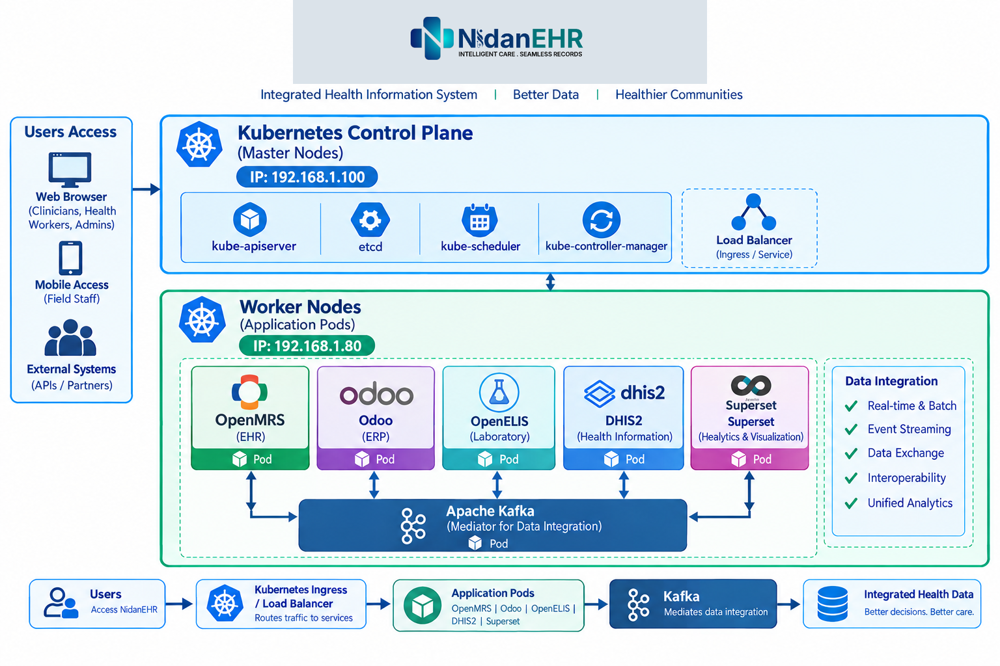

# NidanEHR on K3s — Ubuntu Server 24.04 LTS

**Intelligent Care · Seamless Records**

NidanEHR brings together electronic health records, enterprise resource planning, laboratory information, health information management, and analytics. This guide sets up a lightweight Kubernetes cluster using **K3s** on two Ubuntu Server 24.04 LTS nodes, with Apache Kafka planned as the data-integration layer.

> **Scope:** This guide installs the K3s cluster and outlines the application deployment plan. Installing K3s does not automatically deploy OpenMRS, Odoo, OpenELIS, DHIS2, Superset, their databases, or Kafka connectors. Those workloads require suitable manifests or Helm charts, images, configuration, secrets, and persistent storage.

## Architecture

| Node / component | Address or purpose |
|---|---|
| K3s server / control plane | `192.168.1.100` |
| K3s agent / worker | `192.168.1.80` |
| OpenMRS | Electronic Health Records (EHR) |
| Odoo | Enterprise Resource Planning (ERP) |
| OpenELIS | Laboratory Information System |
| DHIS2 | Health information management |
| Apache Superset | Analytics and visualization |
| Apache Kafka | Event streaming and data integration |




## 1. Prerequisites

Run the node configuration steps on **both nodes**, unless stated otherwise.

- Ubuntu Server 24.04 LTS with sudo access.
- Static IPs: `192.168.1.100` (K3s server) and `192.168.1.80` (K3s agent).
- Reliable two-way connectivity between nodes.
- Starting recommendation: 2+ CPU cores and 4 GB RAM for the server; 4+ CPU cores and 8–16 GB RAM for the worker. Running all applications and databases may need significantly more.
- SSD storage suitable for application data, databases, and Kafka.
- A pod network range that does not overlap with your LAN, VPN, or other routed networks.

Check the OS and network:

```bash
lsb_release -a
ip -br address
ip route
```

## 2. Set hostnames and host resolution

On `192.168.1.100`:

```bash
sudo hostnamectl set-hostname nidanehr-k3s-server
```

On `192.168.1.80`:

```bash
sudo hostnamectl set-hostname nidanehr-k3s-worker-01
```

On **both nodes**, add these entries to `/etc/hosts`:

```text
192.168.1.100 nidanehr-k3s-server
192.168.1.80  nidanehr-k3s-worker-01
```

Edit the file with:

```bash
sudo nano /etc/hosts
```

Ensure the IP addresses are reserved and do not conflict with DHCP assignments.

## 3. Network and firewall requirements

Allow communication between the nodes and any required client networks. For a typical K3s setup, the worker must reach the server API on TCP port `6443`. With the default Flannel VXLAN backend, allow UDP port `8472` between nodes. Kubelet metrics/health and other ports should be restricted to the cluster network and opened only when required by your configuration.

Do **not** expose the Kubernetes API, etcd, or Kafka publicly. If UFW or another firewall is enabled, create narrowly scoped rules for the trusted LAN and your chosen networking configuration. Consult the official K3s requirements for your selected version and CNI.

## 4. Install K3s server (control plane)

Run this section **only on `192.168.1.100`**.

Install K3s using the official installer, binding the node to the intended LAN IP:

```bash
curl -sfL https://get.k3s.io | sudo sh -s - server \
  --node-name nidan-k3s \
  --node-ip 192.168.1.100 \
  --tls-san 192.168.1.100
```

This uses K3s's bundled container runtime and default Flannel networking. You do **not** need to install containerd, kubeadm, or kubelet separately for a standard K3s installation.

Check the service:

```bash
sudo systemctl status k3s --no-pager
sudo k3s kubectl get nodes -o wide
sudo k3s kubectl get pods -A
```

Configure kubectl for your normal user (optional). K3s stores its admin kubeconfig at `/etc/rancher/k3s/k3s.yaml`:

```bash
mkdir -p "$HOME/.kube"
sudo cp /etc/rancher/k3s/k3s.yaml "$HOME/.kube/config"
sudo chown "$(id -u):$(id -g)" "$HOME/.kube/config"
chmod 600 "$HOME/.kube/config"
```

The kubeconfig normally points to `127.0.0.1`. That works on the server itself. If you use it from another machine, securely copy it and change the server endpoint to `https://192.168.1.100:6443`; protect the file because it grants administrative access.

## 5. Join the worker node

On the K3s server, retrieve the node token:

```bash
sudo cat /var/lib/rancher/k3s/server/node-token
```

Treat this token as a secret. Do not commit it to GitHub, paste it into public issues, or include it in screenshots.

On `192.168.1.80`, install the K3s agent and point it at the server:

```bash
curl -sfL https://get.k3s.io | sudo env \
  K3S_URL=https://192.168.1.100:6443 \
  K3S_TOKEN='Server_Token' \
  sh -s - agent \
  --node-name nindan-k3-worker \
  --node-ip 192.168.1.80

```

Replace `<PASTE_NODE_TOKEN_HERE>` with the token retrieved from the server. Do not type the angle brackets literally.

To support Kubectl command on worker node:
```bash
scp /etc/rancher/k3s/k3s.yaml kubernet@192.168.1.80:/tmp/k3s.yaml
mkdir -p $HOME/.kube
sudo mv /tmp/k3s.yaml $HOME/.kube/config
sudo chown $(id -u):$(id -g) $HOME/.kube/config
sudo sed -i 's/127.0.0.1/192.168.1.100/g' $HOME/.kube/config
```

Check the agent service on the worker:

```bash
sudo systemctl status k3s-agent --no-pager
```

Then, on the server:

```bash
sudo k3s kubectl get nodes -o wide
```

Both nodes should eventually report `Ready`.

## 6. Create the NidanEHR namespace

Run on the K3s server:

```bash
sudo k3s kubectl create namespace nidanehr
sudo k3s kubectl get namespaces
```

If you configured a local kubectl context using the K3s kubeconfig, you can use `kubectl` instead of `sudo k3s kubectl`.

## 7. Storage planning

K3s commonly installs a default local-path storage provisioner. Local-path volumes are tied to a node and are **not** a substitute for replicated, highly available storage.

Inspect storage classes:

```bash
sudo k3s kubectl get storageclass
sudo k3s kubectl get pv,pvc -A
```

Plan persistent storage for application databases, uploaded files, Kafka data, and analytics. For production, use a storage solution with documented backup, restore, capacity, and node-failure behavior.

## 8. Deploy the NidanEHR applications

Suggested repository structure:

```text
nidan-kubernet/
├── Docs/
├── nidan-chart/
├── nidan-k3s/
│   ├── Dhis2/
│   ├── Integration/
│   ├── Odoo/
│   ├── Openelis/
│   ├── Openmrs/
│   ├── Orthanc/
│   ├── Proxy/
│   └── Superset/
├── openelis-files/
├── proxy-nginx/
└── README.md


**Build Proxy(Gateway) Image for NidanEHR** The folder proxy-nginx contain the necessary files with Dockerfile to build the own gateway
```bash
cd proxy-nginx/
docker build -t nidan-gateway:latest .
```
Step to load locally build image to k3s:

```bash
docker save nidan-proxy:latest -o /tmp/nidan-proxy.tar
sudo k3s ctr -n k8s.io images import /tmp/nidan-proxy.tar

sudo k3s ctr -n k8s.io images ls | grep nidan-proxy

sudo k3s crictl images | grep nidan-proxy

sudo k3s crictl rmi <IMAGE_ID>
```

**Disable Ingress** As we are using our own gateway image so need to disable ingress

```bash
vi /etc/rancher/k3s/config.yaml
disable:
  - traefik
kube-apiserver-arg:
  - "service-node-port-range=80-32767"

```
**PODS Deployment** For the deployment of pods with in NidanEHR Namespace a folder nidan-k3s contain the every yaml file of each application
```bash
kubectl apply -f openmrs.yaml   ------Openmrs folder contain openrms.yaml
kubectl apply -f openelis.yaml  ------Openelis folder contain openrms.yaml
kubectl apply -f odoo.yaml       ------Odoo folder contain openrms.yaml
kubectl apply -f dhis2.yaml      ------Dhis2 folder contain openrms.yaml

In this way overall of the Pods can be deployed through the respective folders containing yaml file.

```
Before deployment of Openelis application some secrets and configmap is need to generate so to procced:
openelis-files folder contain the necessary files for generating the secrets and cconfigmap so run the belown command with in the openelis-files
```bash
cd openelis
 kubectl -n nidan create configmap openelis-config-files \
  --from-file=server.xml=tomcat/server.xml \
  --from-file=common.properties=volume/properties/common.properties \
  --dry-run=client -o yaml | kubectl apply -f -


kubectl -n nidan create secret generic openelis-certs \
  --from-file=volume/certs \
  --dry-run=client -o yaml | kubectl apply -f -


cd openelis/volume/configuration/backend/ocl/
kubectl -n nidan create configmap openelis-ocl-import \
  --from-file=TTH_Laboratory_v0.4.2026-05-07_100938.zip
```
  Then only after deploy the openelis.yaml


**Protect healthcare data:** Use authenticated services, TLS, least-privilege topic permissions, audit logging, and approved data-sharing rules. Avoid placing identifiable patient data in broadly accessible topics or logs.

A single worker node is not a highly available Kafka deployment. Size and distribute brokers and persistent storage according to the required reliability and workload.

## 11. Verify the cluster and troubleshoot

Run on the server:

```bash
sudo k3s kubectl get nodes -o wide
sudo k3s kubectl get pods -A
sudo k3s kubectl get services -n nidanehr
sudo k3s kubectl get pvc -n nidanehr
sudo k3s kubectl get ingress -A
```

Inspect a failing workload:

```bash
sudo k3s kubectl describe pod <pod-name> -n nidanehr
sudo k3s kubectl logs <pod-name> -n nidanehr --previous
```

Check service logs:

On the server:

```bash
sudo journalctl -u k3s -n 200 --no-pager
```

On the worker:

```bash
sudo journalctl -u k3s-agent -n 200 --no-pager
```

Common checks:

- **Node `NotReady`:** inspect K3s service logs, node connectivity, firewall rules, and CNI pods.
- **Pod `Pending`:** check available CPU/memory, storage claims, and scheduling events.
- **`CrashLoopBackOff`:** inspect application logs, database access, credentials, and configuration.
- **Application unreachable:** check Services, Ingress, DNS, TLS, and firewall rules.
- **Kafka events not flowing:** check broker health, topic permissions, consumer lag, schema compatibility, and connector logs.

## 12. Security and production readiness

This two-node topology is a starting point for development or controlled testing, not a highly available production design. Before using real clinical data:

- Add redundancy for control-plane services, workers, storage, databases, and critical workloads.
- Configure and test backups and disaster recovery.
- Restrict API access and enforce Kubernetes RBAC.
- Use a secrets manager or appropriately protected Kubernetes Secrets.
- Enable TLS, network policies, audit logging, and monitoring.
- Test upgrades, restores, capacity, and node-failure scenarios.
- Validate applicable healthcare privacy, retention, and audit requirements.

## Official documentation

- K3s quick start: https://docs.k3s.io/quick-start
- K3s server options: https://docs.k3s.io/cli/server
- K3s networking requirements: https://docs.k3s.io/installation/requirements
- K3s storage: https://docs.k3s.io/storage
- Kubernetes Ingress: https://kubernetes.io/docs/concepts/services-networking/ingress/
- OpenMRS: https://openmrs.org/
- Odoo documentation: https://www.odoo.com/documentation/
- OpenELIS Global: https://openelis-global.org/
- DHIS2: https://dhis2.org/
- Apache Kafka: https://kafka.apache.org/documentation/
- Apache Superset: https://superset.apache.org/docs/intro/

---

**Project:** NidanEHR
**Operating system:** Ubuntu Server 24.04 LTS
**Kubernetes distribution:** K3s
**Server / control plane:** `192.168.1.100`
**Worker / agent:** `192.168.1.80`
**Data integration:** Apache Kafka
